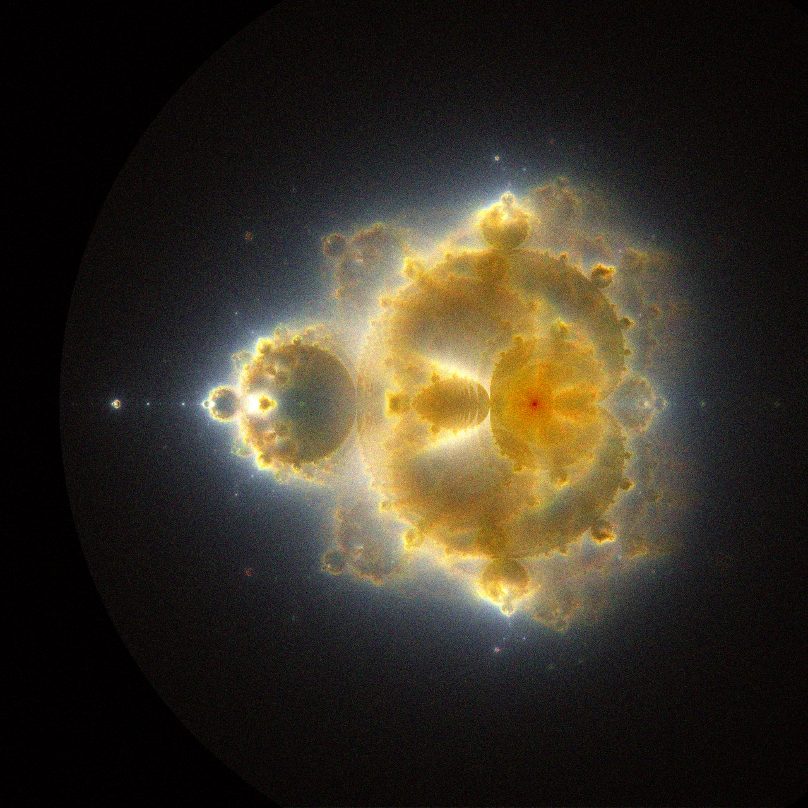

# Brot Farm 🌀

[](https://github.com/Prekzursil/brot-farm/actions/workflows/ci.yml)
[](https://prekzursil.github.io/brot-farm/)
[](LICENSE)

**Long-exposure photographs of mathematical escape.** A Buddhabrot family renderer:
instead of asking *"does this point escape?"*, it asks *"where does it travel on the way out?"*
— and plots millions of escaping orbits as a density image. Plus 17 sibling fractals grown
from the same idea: Antibuddhabrot, Nebulabrot, power mandalas (z³/z⁴/z⁵), Burning Ship,
Tricorn, Celtic, Buffalo, sin/cos entire-function brots, Julia-brot, and a family of
custom cosine/tan/sinh/exp mutations.



*Every image on this page is a 2-D histogram of orbit visitation counts — no raytracing,
no painting, just `z ↦ z² + c` iterated a few hundred million times.*

## Try it in the browser

The [**Playground**](https://prekzursil.github.io/brot-farm/playground.html) runs live in
your browser (no install, no server): animate single orbits Alan-Becker-style, watch a
Buddhabrot develop like a photograph in real time, zoom a Mandelbrot explorer, and write
your own iteration formulas in a sandbox. The [Math guide](https://prekzursil.github.io/brot-farm/math.html)
and [Code walkthrough](https://prekzursil.github.io/brot-farm/code.html) explain everything
in depth, with interactive diagrams.

## Quickstart (Python)

```bash
pip install -r requirements.txt

# the classic 2048² Buddhabrot (74M samples, ~3 min on a laptop CPU)
python buddhabrot.py render

# your first mutation: x' = cos(x²) − y, y' = 2xy  (~2.5 min)
python cosbrot.py render

# all 17 maps, sharded across 4 processes
python brot_farm.py --shard 0 --shards 4 &
python brot_farm.py --shard 1 --shards 4 &
python brot_farm.py --shard 2 --shards 4 &
python brot_farm.py --shard 3 --shards 4 &

# add samples to a cached histogram without recomputing (canvas-crop built in)
python topup.py z3 1728 12000000 8000000 5000000
```

Outputs land in `out/` as PNG + typography poster. Histograms are cached as `.npy`, so
re-toning (`python buddhabrot.py tone --gamma 1.2`) is instant.

## The idea in one paragraph

Sample a random point `c`. Iterate `zₙ₊₁ = zₙ² + c` starting at `z₀ = 0`. If the orbit
stays bounded forever, `c` is a *prisoner* — it belongs to the Mandelbrot set and its
orbit never draws anything. If the orbit escapes past radius 2, it has traced a path
through the plane first — and *that path* is the picture. Plot every point every escaping
orbit visits into a 2-D histogram, repeat for millions of samples, and the Buddha appears.
Split the work into three channels by iteration depth (80 / 400 / 1500) and shallow
orbits glow blue while deep ones burn red.

## Maps included

| Family | Maps | Signature |
|---|---|---|
| Classic | Buddhabrot, Antibuddhabrot (prisoner orbits), Nebulabrot (caps 50/500/5000), Julia-brot (fixed c = −0.7+0.27i) | the figure |
| Powers | z³+c, z⁴+c, z⁵+c | (n−1)-fold mandalas |
| Folds | Burning Ship, Tricorn, Celtic, Buffalo | absolute values & conjugation break mirror symmetry |
| Entire functions | sin z + c, cos z + c | prisoners confined to a horizontal band |
| Mutations | cos(x²)−y, cos(x²−y²), cos(2xy), tan, sinh, exp variants | asymmetric, chaotic, occasionally pathological (exp has no prisoner set) |

## Architecture (short version)

Two-phase vectorized Monte Carlo, pure numpy, no dependencies beyond numpy/Pillow:

1. **Phase 1 — classify**: batch 3M samples, iterate with periodic array compaction, mark who escapes within the channel's cap. Analytic pre-culling of the main cardioid + period-2 bulb removes ~13% of provably-never-escaping samples for free.
2. **Phase 2 — replay**: re-iterate only the escapees, scatter every pre-escape orbit point into a `bincount`-fed histogram.
3. **Tone map**: log-compress, anchor black/white points at histogram percentiles, gamma, per-channel gains, vibrance.

Full reasoning — why two phases, why `bincount` over `np.add.at`, why float64, why
percentile tone anchors, benchmarks, and the alternatives not taken — lives in the
[Code walkthrough](https://prekzursil.github.io/brot-farm/code.html).

## Tests & CI

```bash
python -m pytest -q          # unit tests: step rules vs complex arithmetic, escape
                             # classification vs scalar reference, tone monotonicity,
                             # histogram bounds, culling soundness, seed determinism,
                             # mirror-symmetry law, plus a tiny end-to-end render
```

CI runs the suite on Python 3.11–3.13 (`.github/workflows/ci.yml`); Pages deploys `docs/`
on every push to `main` (`.github/workflows/pages.yml`).

## License

MIT — see [LICENSE](LICENSE).
